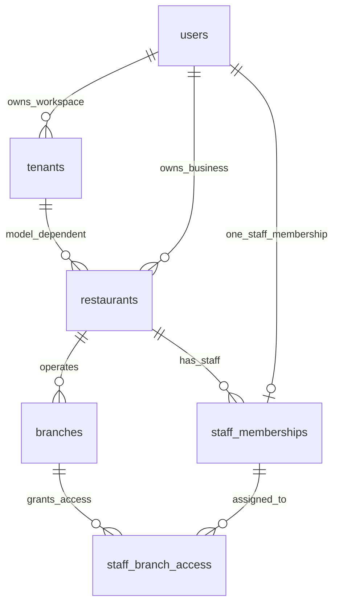
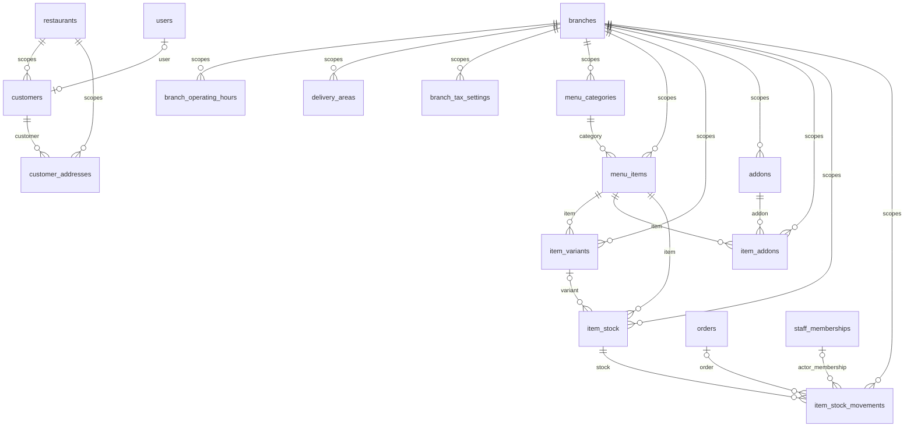
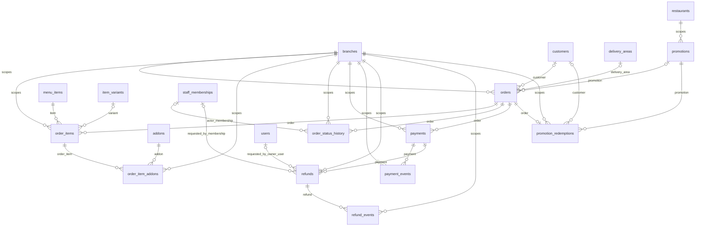
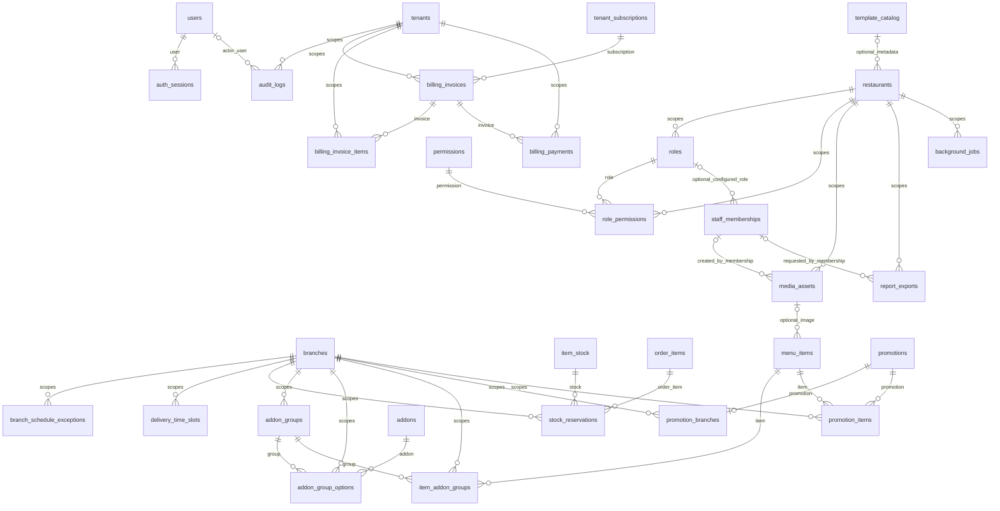

# PLATO entity relationships

Review draft. The tenant boundary remains unresolved: the restaurant alternative limits each tenant to one restaurant; the group alternative allows multiple. All diagrams show the group cardinality superset for comparison, not a selected business model. Refer to [README.md](README.md) for restrictions, snapshots, open decisions and isolation limits.

`||` = exactly one; `o|` = zero or one; `o{` = zero or many. Join tables implement many-to-many relationships. Scope fields/technical UUID keys are listed in the matrix and SQL, rather than repeated in every diagram.

## Tenant and business hierarchy

The superset has no mandatory business-group decision. Onboarding creates the appropriate tenant and restaurant/profile records together; the ownership and group-admin rules still need approval.

## Storefront, catalog and quantity

## Orders, payments, refunds and promotions

## Later operations: POS, kitchen, ingredients and HR

```mermaid
erDiagram
    branches ||--o{ pos_registers : scopes
    branches ||--o{ cash_sessions : scopes
    pos_registers ||--o{ cash_sessions : register
    staff_memberships ||--o{ cash_sessions : cashier_membership
    branches ||--o{ cash_movements : scopes
    cash_sessions ||--o{ cash_movements : session
    payments o|--o{ cash_movements : payment
    branches ||--o{ receipts : scopes
    orders ||--o{ receipts : order
    branches ||--o{ dining_tables : scopes
    branches ||--o{ table_sessions : scopes
    dining_tables ||--o{ table_sessions : table
    customers o|--o{ table_sessions : customer
    branches ||--o{ kitchen_stations : scopes
    branches ||--o{ item_kitchen_stations : scopes
    menu_items ||--o{ item_kitchen_stations : item
    kitchen_stations ||--o{ item_kitchen_stations : station
    branches ||--o{ kitchen_tickets : scopes
    orders ||--o{ kitchen_tickets : order
    kitchen_stations ||--o{ kitchen_tickets : station
    branches ||--o{ kitchen_ticket_items : scopes
    kitchen_tickets ||--o{ kitchen_ticket_items : ticket
    order_items ||--o{ kitchen_ticket_items : order_item
    restaurants ||--o{ ingredients : scopes
    branches ||--o{ ingredient_stock : scopes
    ingredients ||--o| ingredient_stock : ingredient
    branches ||--o{ recipes : scopes
    menu_items ||--o{ recipes : item
    item_variants o|--o{ recipes : variant
    branches ||--o{ recipe_ingredients : scopes
    recipes ||--o{ recipe_ingredients : recipe
    ingredients ||--o{ recipe_ingredients : ingredient
    branches ||--o{ stock_movements : scopes
    ingredient_stock ||--o{ stock_movements : stock
    order_items o|--o{ stock_movements : order_item
    goods_receipt_items o|--o{ stock_movements : receipt_item
    branches ||--o{ stock_batches : scopes
    ingredient_stock ||--o{ stock_batches : stock
    branches ||--o{ waste_records : scopes
    ingredient_stock ||--o{ waste_records : stock
    stock_batches o|--o{ waste_records : batch
    restaurants ||--o{ suppliers : scopes
    branches ||--o{ purchase_orders : scopes
    suppliers ||--o{ purchase_orders : supplier
    branches ||--o{ purchase_order_items : scopes
    purchase_orders ||--o{ purchase_order_items : purchase_order
    ingredients ||--o{ purchase_order_items : ingredient
    branches ||--o{ goods_receipts : scopes
    purchase_orders ||--o{ goods_receipts : purchase_order
    branches ||--o{ goods_receipt_items : scopes
    goods_receipts ||--o{ goods_receipt_items : receipt
    purchase_order_items ||--o{ goods_receipt_items : purchase_order_item
    branches ||--o{ staff_shifts : scopes
    staff_memberships ||--o{ staff_shifts : membership
    branches ||--o{ attendance_records : scopes
    staff_memberships ||--o{ attendance_records : membership
    staff_shifts o|--o{ attendance_records : shift
```

## Later platform, customers, AI and integrations

```mermaid
erDiagram
    restaurants ||--o{ loyalty_accounts : scopes
    customers ||--o| loyalty_accounts : customer
    restaurants ||--o{ loyalty_transactions : scopes
    loyalty_accounts ||--o{ loyalty_transactions : account
    orders o|--o{ loyalty_transactions : order
    restaurants ||--o{ customer_segments : scopes
    restaurants ||--o{ customer_segment_members : scopes
    customer_segments ||--o{ customer_segment_members : segment
    customers ||--o{ customer_segment_members : customer
    restaurants ||--o{ campaigns : scopes
    customer_segments o|--o{ campaigns : segment
    restaurants ||--o{ campaign_recipients : scopes
    campaigns ||--o{ campaign_recipients : campaign
    customers ||--o{ campaign_recipients : customer
    branches ||--o{ forecast_runs : scopes
    branches ||--o{ demand_forecasts : scopes
    forecast_runs ||--o{ demand_forecasts : run
    menu_items ||--o{ demand_forecasts : item
    branches ||--o{ forecast_evaluations : scopes
    forecast_runs ||--o{ forecast_evaluations : run
    branches ||--o{ ai_recommendations : scopes
    forecast_runs o|--o{ ai_recommendations : run
    menu_items o|--o{ ai_recommendations : item
    ingredients o|--o{ ai_recommendations : ingredient
    branches ||--o{ recommendation_decisions : scopes
    ai_recommendations ||--o{ recommendation_decisions : recommendation
    staff_memberships o|--o{ recommendation_decisions : manager_membership
    users o|--o{ recommendation_decisions : owner_user
    plans ||--o{ plan_limits : plan
    tenants ||--o{ tenant_subscriptions : scopes
    plans ||--o{ tenant_subscriptions : plan
    tenants ||--o{ tenant_usage : scopes
    branches ||--o{ sync_devices : scopes
    branches ||--o{ sync_operations : scopes
    sync_devices ||--o{ sync_operations : device
    branches ||--o{ sync_conflicts : scopes
    sync_operations ||--o{ sync_conflicts : operation
    staff_memberships o|--o{ sync_conflicts : resolved_by_membership
    restaurants ||--o{ integration_connections : scopes
    restaurants ||--o{ integration_events : scopes
    integration_connections ||--o{ integration_events : connection
    restaurants ||--o{ notification_deliveries : scopes
    integration_connections o|--o{ notification_deliveries : connection
    campaign_recipients o|--o{ notification_deliveries : campaign_recipient
    orders o|--o{ notification_deliveries : order
    customers o|--o{ notification_deliveries : customer
```

## Conditional modules and supporting entities

## Relationship matrix (all 93 entities)

Every table has `id UUID` as PK. Business tables also have a scoped UNIQUE key and FKs carrying the parent's scope. The SQL includes extra same-item, same-order, same-purchase-order and same-staff constraints beyond the simplified diagram arrows. Optional FK values are nullable; tenant/restaurant/branch scope identifiers are required except explicitly optional restaurant/branch metadata.

| Table | Scope / unique reference key | Domain parents (besides scope) |
| --- | --- | --- |
| `users` | global; `id` | Scope parent only, or standalone platform entity. |
| `tenants` | global; `id` | `user_id` → `users` |
| `restaurants` | tenant; `tenant_id,id` | `owner_user_id` → `users`; optional `template_catalog_id` → `template_catalog` (conditional) |
| `branches` | restaurant; `tenant_id,restaurant_id,id` | Scope parent only, or standalone platform entity. |
| `staff_memberships` | restaurant; `tenant_id,restaurant_id,id` | `user_id` → `users`; optional `configured_role_id` → `roles` (conditional) |
| `staff_branch_access` | branch; `tenant_id,restaurant_id,branch_id,id` | `membership_id` → `staff_memberships` |
| `branch_operating_hours` | branch; `tenant_id,restaurant_id,branch_id,id` | Scope parent only, or standalone platform entity. |
| `delivery_areas` | branch; `tenant_id,restaurant_id,branch_id,id` | Scope parent only, or standalone platform entity. |
| `branch_tax_settings` | branch; `tenant_id,restaurant_id,branch_id,id` | Scope parent only, or standalone platform entity. |
| `customers` | restaurant; `tenant_id,restaurant_id,id` | `user_id` → `users` (optional) |
| `customer_addresses` | restaurant; `tenant_id,restaurant_id,id` | `customer_id` → `customers` |
| `menu_categories` | branch; `tenant_id,restaurant_id,branch_id,id` | Scope parent only, or standalone platform entity. |
| `menu_items` | branch; `tenant_id,restaurant_id,branch_id,id` | `category_id` → `menu_categories`; optional `media_asset_id` → `media_assets` (conditional) |
| `item_variants` | branch; `tenant_id,restaurant_id,branch_id,id` | `item_id` → `menu_items` |
| `addons` | branch; `tenant_id,restaurant_id,branch_id,id` | Scope parent only, or standalone platform entity. |
| `item_addons` | branch; `tenant_id,restaurant_id,branch_id,id` | `item_id` → `menu_items`; `addon_id` → `addons` |
| `item_stock` | branch; `tenant_id,restaurant_id,branch_id,id` | `item_id` → `menu_items`; `variant_id` → `item_variants` (optional) |
| `item_stock_movements` | branch; `tenant_id,restaurant_id,branch_id,id` | `stock_id` → `item_stock`; `order_id` → `orders` (optional); `actor_membership_id` → `staff_memberships` (optional) |
| `orders` | branch; `tenant_id,restaurant_id,branch_id,id` | `customer_id` → `customers` (optional); `delivery_area_id` → `delivery_areas` (optional); `promotion_id` → `promotions` (optional) |
| `order_items` | branch; `tenant_id,restaurant_id,branch_id,id` | `order_id` → `orders`; `item_id` → `menu_items`; `variant_id` → `item_variants` (optional) |
| `order_item_addons` | branch; `tenant_id,restaurant_id,branch_id,id` | `order_item_id` → `order_items`; `addon_id` → `addons`; same-item `item_addons` eligibility and `order_items` item identity |
| `order_status_history` | branch; `tenant_id,restaurant_id,branch_id,id` | `order_id` → `orders`; `actor_membership_id` → `staff_memberships` (optional) |
| `payments` | branch; `tenant_id,restaurant_id,branch_id,id` | `order_id` → `orders` |
| `payment_events` | branch; `tenant_id,restaurant_id,branch_id,id` | `payment_id` → `payments` |
| `refunds` | branch; `tenant_id,restaurant_id,branch_id,id` | `payment_id` → `payments`; `requested_by_membership_id` → `staff_memberships` (optional); `requested_by_owner_user_id` → `users` (optional) |
| `refund_events` | branch; `tenant_id,restaurant_id,branch_id,id` | `refund_id` → `refunds` |
| `promotions` | restaurant; `tenant_id,restaurant_id,id` | optional `branch_id` → `branches` (branch_offer requires it) |
| `promotion_redemptions` | branch; `tenant_id,restaurant_id,branch_id,id` | `promotion_id` → `promotions`; `order_id` → `orders`; `customer_id` → `customers` (optional) |
| `pos_registers` | branch; `tenant_id,restaurant_id,branch_id,id` | Scope parent only, or standalone platform entity. |
| `cash_sessions` | branch; `tenant_id,restaurant_id,branch_id,id` | `register_id` → `pos_registers`; `cashier_membership_id` → `staff_memberships` |
| `cash_movements` | branch; `tenant_id,restaurant_id,branch_id,id` | `session_id` → `cash_sessions`; `payment_id` → `payments` (optional) |
| `receipts` | branch; `tenant_id,restaurant_id,branch_id,id` | `order_id` → `orders` |
| `dining_tables` | branch; `tenant_id,restaurant_id,branch_id,id` | Scope parent only, or standalone platform entity. |
| `table_sessions` | branch; `tenant_id,restaurant_id,branch_id,id` | `table_id` → `dining_tables`; `customer_id` → `customers` (optional) |
| `kitchen_stations` | branch; `tenant_id,restaurant_id,branch_id,id` | Scope parent only, or standalone platform entity. |
| `item_kitchen_stations` | branch; `tenant_id,restaurant_id,branch_id,id` | `item_id` → `menu_items`; `station_id` → `kitchen_stations` |
| `kitchen_tickets` | branch; `tenant_id,restaurant_id,branch_id,id` | `order_id` → `orders`; `station_id` → `kitchen_stations` |
| `kitchen_ticket_items` | branch; `tenant_id,restaurant_id,branch_id,id` | `ticket_id` → `kitchen_tickets`; `order_item_id` → `order_items` |
| `ingredients` | restaurant; `tenant_id,restaurant_id,id` | Scope parent only, or standalone platform entity. |
| `ingredient_stock` | branch; `tenant_id,restaurant_id,branch_id,id` | `ingredient_id` → `ingredients` |
| `recipes` | branch; `tenant_id,restaurant_id,branch_id,id` | `item_id` → `menu_items`; `variant_id` → `item_variants` (optional) |
| `recipe_ingredients` | branch; `tenant_id,restaurant_id,branch_id,id` | `recipe_id` → `recipes`; `ingredient_id` → `ingredients` |
| `stock_movements` | branch; `tenant_id,restaurant_id,branch_id,id` | `stock_id` → `ingredient_stock`; `order_item_id` → `order_items` (optional); `receipt_item_id` → `goods_receipt_items` (optional) |
| `stock_batches` | branch; `tenant_id,restaurant_id,branch_id,id` | `stock_id` → `ingredient_stock` |
| `waste_records` | branch; `tenant_id,restaurant_id,branch_id,id` | `stock_id` → `ingredient_stock`; `batch_id` → `stock_batches` (optional) |
| `suppliers` | restaurant; `tenant_id,restaurant_id,id` | Scope parent only, or standalone platform entity. |
| `purchase_orders` | branch; `tenant_id,restaurant_id,branch_id,id` | `supplier_id` → `suppliers` |
| `purchase_order_items` | branch; `tenant_id,restaurant_id,branch_id,id` | `purchase_order_id` → `purchase_orders`; `ingredient_id` → `ingredients` |
| `goods_receipts` | branch; `tenant_id,restaurant_id,branch_id,id` | `purchase_order_id` → `purchase_orders` |
| `goods_receipt_items` | branch; `tenant_id,restaurant_id,branch_id,id` | `receipt_id` → `goods_receipts`; `purchase_order_item_id` → `purchase_order_items` |
| `staff_shifts` | branch; `tenant_id,restaurant_id,branch_id,id` | `membership_id` → `staff_memberships` |
| `attendance_records` | branch; `tenant_id,restaurant_id,branch_id,id` | `membership_id` → `staff_memberships`; `shift_id` → `staff_shifts` (optional) |
| `loyalty_accounts` | restaurant; `tenant_id,restaurant_id,id` | `customer_id` → `customers` |
| `loyalty_transactions` | restaurant; `tenant_id,restaurant_id,id` | `account_id` → `loyalty_accounts`; `order_id` → `orders` (optional) |
| `customer_segments` | restaurant; `tenant_id,restaurant_id,id` | Scope parent only, or standalone platform entity. |
| `customer_segment_members` | restaurant; `tenant_id,restaurant_id,id` | `segment_id` → `customer_segments`; `customer_id` → `customers` |
| `campaigns` | restaurant; `tenant_id,restaurant_id,id` | `segment_id` → `customer_segments` (optional) |
| `campaign_recipients` | restaurant; `tenant_id,restaurant_id,id` | `campaign_id` → `campaigns`; `customer_id` → `customers` |
| `forecast_runs` | branch; `tenant_id,restaurant_id,branch_id,id` | Scope parent only, or standalone platform entity. |
| `demand_forecasts` | branch; `tenant_id,restaurant_id,branch_id,id` | `run_id` → `forecast_runs`; `item_id` → `menu_items` |
| `forecast_evaluations` | branch; `tenant_id,restaurant_id,branch_id,id` | `run_id` → `forecast_runs` |
| `ai_recommendations` | branch; `tenant_id,restaurant_id,branch_id,id` | `run_id` → `forecast_runs` (optional); `item_id` → `menu_items` (optional); `ingredient_id` → `ingredients` (optional) |
| `recommendation_decisions` | branch; `tenant_id,restaurant_id,branch_id,id` | `recommendation_id` → `ai_recommendations`; `manager_membership_id` → `staff_memberships` (optional); `owner_user_id` → `users` (optional) |
| `plans` | global; `id` | Scope parent only, or standalone platform entity. |
| `plan_limits` | global; `id` | `plan_id` → `plans` |
| `tenant_subscriptions` | tenant; `tenant_id,id` | `plan_id` → `plans` |
| `tenant_usage` | tenant; `tenant_id,id` | Scope parent only, or standalone platform entity. |
| `sync_devices` | branch; `tenant_id,restaurant_id,branch_id,id` | Scope parent only, or standalone platform entity. |
| `sync_operations` | branch; `tenant_id,restaurant_id,branch_id,id` | `device_id` → `sync_devices` |
| `sync_conflicts` | branch; `tenant_id,restaurant_id,branch_id,id` | `operation_id` → `sync_operations`; `resolved_by_membership_id` → `staff_memberships` (optional) |
| `integration_connections` | restaurant; `tenant_id,restaurant_id,id` | Scope parent only, or standalone platform entity. |
| `integration_events` | restaurant; `tenant_id,restaurant_id,id` | `connection_id` → `integration_connections` |
| `notification_deliveries` | restaurant; `tenant_id,restaurant_id,id` | `connection_id` → `integration_connections` (optional); `campaign_recipient_id` → `campaign_recipients` (optional); `order_id` → `orders` (optional); `customer_id` → `customers` (optional) |
| `roles` | restaurant; `tenant_id,restaurant_id,id` | Scope parent only, or standalone platform entity. |
| `permissions` | global; `id` | Scope parent only, or standalone platform entity. |
| `role_permissions` | restaurant; `tenant_id,restaurant_id,id` | `role_id` → `roles`; `permission_id` → `permissions` |
| `auth_sessions` | global; `id` | `user_id` → `users` |
| `branch_schedule_exceptions` | branch; `tenant_id,restaurant_id,branch_id,id` | Scope parent only, or standalone platform entity. |
| `delivery_time_slots` | branch; `tenant_id,restaurant_id,branch_id,id` | Scope parent only, or standalone platform entity. |
| `stock_reservations` | branch; `tenant_id,restaurant_id,branch_id,id` | `stock_id` → `item_stock`; `order_item_id` → `order_items` |
| `addon_groups` | branch; `tenant_id,restaurant_id,branch_id,id` | Scope parent only, or standalone platform entity. |
| `addon_group_options` | branch; `tenant_id,restaurant_id,branch_id,id` | `group_id` → `addon_groups`; `addon_id` → `addons` |
| `item_addon_groups` | branch; `tenant_id,restaurant_id,branch_id,id` | `item_id` → `menu_items`; `group_id` → `addon_groups` |
| `promotion_branches` | branch; `tenant_id,restaurant_id,branch_id,id` | `promotion_id` → `promotions` |
| `promotion_items` | branch; `tenant_id,restaurant_id,branch_id,id` | `promotion_id` → `promotions`; `item_id` → `menu_items` |
| `template_catalog` | global; `id` | Scope parent only, or standalone platform entity. |
| `media_assets` | restaurant; `tenant_id,restaurant_id,id` | `created_by_membership_id` → `staff_memberships` (optional) |
| `report_exports` | restaurant; `tenant_id,restaurant_id,id` | `requested_by_membership_id` → `staff_memberships` (optional) |
| `background_jobs` | restaurant; `tenant_id,restaurant_id,id` | Scope parent only, or standalone platform entity. |
| `audit_logs` | tenant; `tenant_id,id` | `actor_user_id` → `users` (optional); optional `restaurant_id` → `restaurants` |
| `billing_invoices` | tenant; `tenant_id,id` | `subscription_id` → `tenant_subscriptions` |
| `billing_invoice_items` | tenant; `tenant_id,id` | `invoice_id` → `billing_invoices` |
| `billing_payments` | tenant; `tenant_id,id` | `invoice_id` → `billing_invoices` |

## Important cardinalities

- Each restaurant has many branches; each branch has its own menu categories/items, stock and orders.
- One staff membership can have many branch assignments, and each branch can have many assigned staff.
- One customer profile can have many addresses and orders; an order may be a guest order with no profile.
- Items have many variants and many allowed add-ons through mappings. Optional grouped add-ons are a separate extension.
- An order has many lines, status events and payment attempts. A line has many selected add-ons. A refund references one payment; full-refund/idempotency business rules still require transactional services.
- One recipe has many ingredient rows. Each ingredient has a stock record per branch. Movements/batches/receipts link to their actual stock/purchase parents.
- Order, payment, stock and audit history is retained through RESTRICT FKs and archived master records; data deletion policy still needs approval.

The SQL files define 217 foreign keys, including scoped parent links and the extra consistency FKs. Count is a verification detail, not a target for the production architecture.
